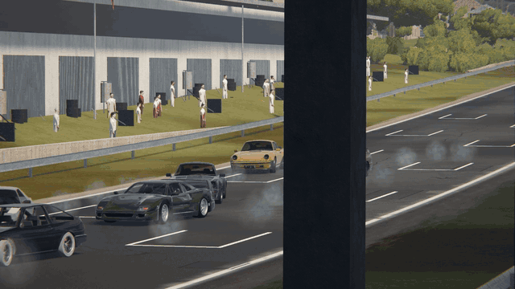
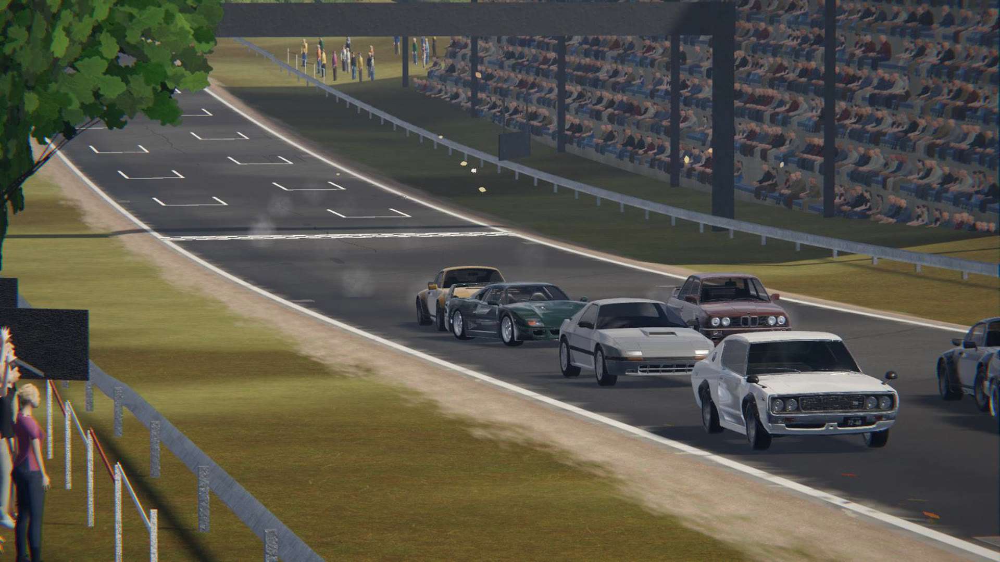
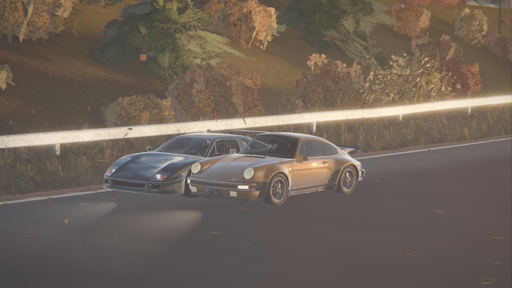
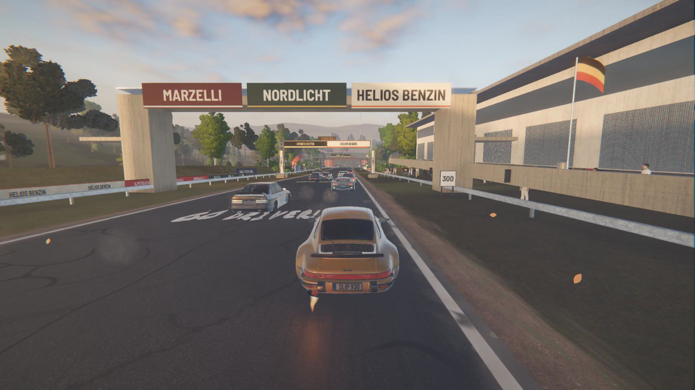
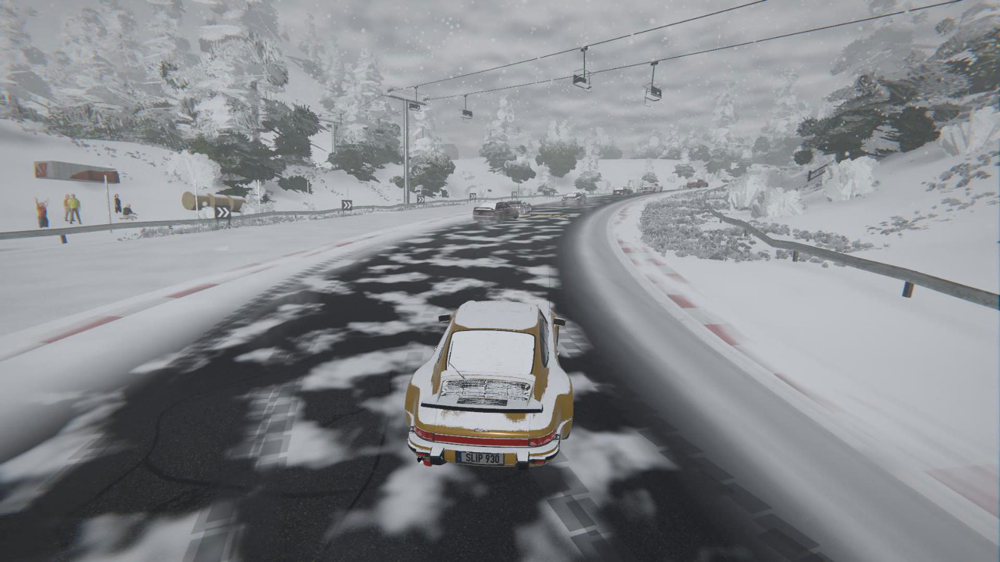
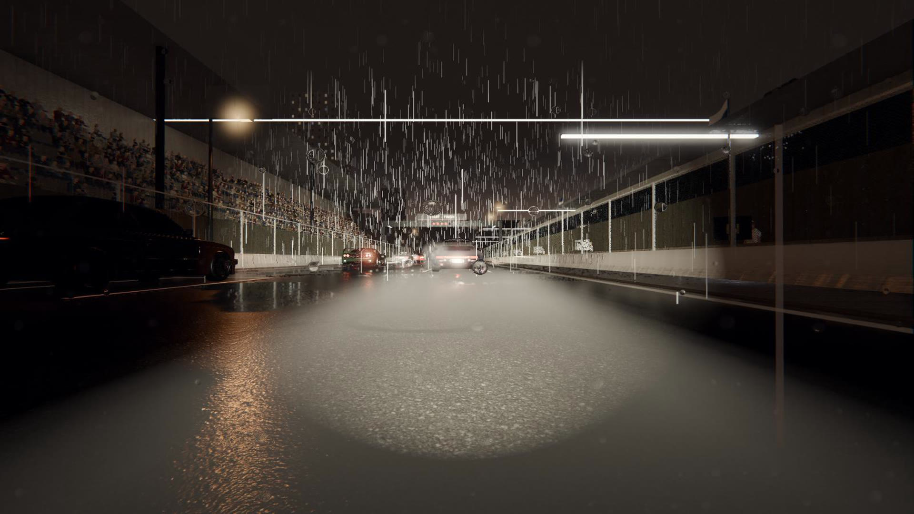

# Slipstream

**An old-school circuit racer with classic 70s–80s sports cars, built in Godot 4.**
Inspired by *Need for Speed: Porsche Unleashed*, WRC and *Burnout Paradise*: arcade-leaning
handling, real-world-looking tracks, changing weather, and LAN multiplayer for up to 8 players.


https://github.com/user-attachments/assets/52d83177-a7af-4ce9-97b9-ff730ed3fda6




| | |
|---|---|
|  |  |
|  |  |



## Features

- **12 circuits**: forest, moorland, alpine pass, Italian autodromo, Mediterranean coast,
  German old town, autumn valley, a night harbour street circuit and more.
- **6 classic cars**: Porsche 911 Turbo (930), Ferrari F40, BMW M3 (E30), Mazda RX-7 (FC),
  Datsun 240K GT and Toyota Sprinter Trueno (AE86).
- **Weather & time of day**: clear, golden hour, dawn, fog, storm, snow, night, night rain,
  and *changeable* races where the weather turns mid-race.
- **Bots** on Easy / Medium / Hard that drive a real racing line, brake late and overtake.
- **LAN / VPN multiplayer**: up to 8 players, automatic game discovery on the local network.
- **Cameras**: chase, cockpit, bumper, bonnet, roof and a TV director cam.
- **Trackside life**: crowds, marshals, wildlife, birds, graffiti, billboards,
  drive-through warehouses, bridges and tunnels.
- Native **macOS and Windows** builds, rebindable keyboard + gamepad controls.

## Download & play

Grab the latest build from the [Releases](../../releases) page, or run from source with
[Godot 4.7](https://godotengine.org/download):

```sh
godot --path .            # play (opens the main menu)
godot -e --path .         # open the editor
```

The macOS build is ad-hoc signed: right-click → Open the first time.

## Playing with friends (LAN)

1. One player picks **Host LAN Race**, chooses track/laps/bots, **Create Lobby**.
2. Everyone else on the same network picks **Join LAN Race**. The race shows up
   in the list automatically (or type the host's IP address).
3. Host presses **Start Race**. After the race the host takes everyone back to the lobby.

Ports: UDP 27015 (game), UDP 27016 (LAN discovery). Allow the game through
the macOS / Windows firewall when asked.

Over the internet: everyone joins the same ZeroTier or Radmin VPN network (then
it works exactly like LAN), or the host forwards UDP 27015 on their router and
friends join by the host's public IP.

## Controls

| Action | Keyboard | Gamepad |
|---|---|---|
| Throttle / brake | W / S (or arrows) | RT / LT |
| Steer | A / D | Left stick |
| Handbrake (start a drift) | Space | A |
| Shift up / down | E / Q | RB / LB |
| Auto / manual gearbox | T | |
| Driving assists on/off | X | |
| Camera (chase / cockpit / far / bumper / bonnet / roof / TV) | C | Y |
| Look back / left / right | B / Z / V | RS click |
| Reset to track | R | View (Back) |
| Pause | Esc | Menu (Start) |

Every action can be rebound (two keys + one gamepad input each) under
**Settings → Controls**, with *Reset to defaults*. Settings also has display
(window mode, V-Sync, render resolution with FSR 1 / FSR 2 upscaling), per-bus
volumes (Master / Engines / Effects / Ambience) and km/h or mph.

## Building

```sh
godot --headless --path . --export-release "macOS"   export/macos/Slipstream.zip
godot --headless --path . --export-release "Windows" export/windows/Slipstream.exe
```

## Layout

- `scripts/car/`: vehicle physics (`car.gd`), body/wheel mesh generator, tyre smoke & skid marks, audio.
- `scripts/race/`: race manager (grid, lights, laps, results, network sync), AI driver, racing line.
- `scripts/track/`: track catalogue, spline → road/curbs/gravel/guardrails, trackside props.
- `scripts/world/`: sky, lighting, terrain, hills, forest.
- `scripts/autoload/`: `Game` (settings), `Net` (LAN host/join/discovery).
- `scripts/ui/`: menu, HUDs, theme.
- `tests/`: headless handling rig (`handling_test.tscn`), screenshot helpers.

Headless checks: `godot --headless --path . res://tests/handling_test.tscn` and
`godot --headless --fixed-fps 120 --path . res://scenes/race.tscn -- --allbots --laps=2`.

## License & credits

- Code and original assets: **MIT** (see [LICENSE](LICENSE)). You may use,
  modify and sell it; keep the copyright notice / credit.
- Third-party models, textures, photos, sounds and fonts keep their own licenses
  (CC0, CC BY, CC BY-SA, SIL OFL, Apache 2.0, public domain). See [CREDITS.md](CREDITS.md)
  and the in-game **Credits** screen.
- Car makes and model names are trademarks of their respective owners. This is an
  independent fan project, not affiliated with or endorsed by them.
